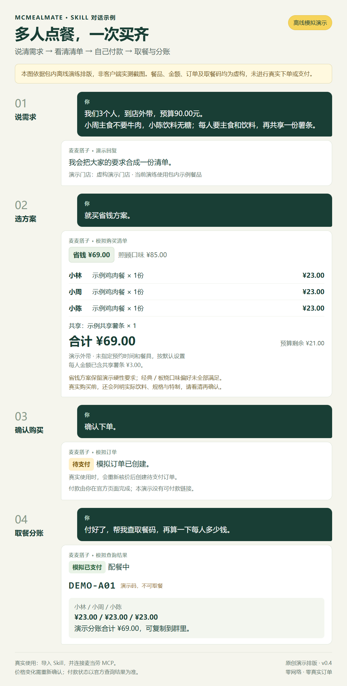

# 麦麦搭子 McMealMate Skill

**在聊天里把大家的饭买齐：选餐、核价、确认下单、查取餐码、算分账。**

> 我们3个人，人民广场附近外带，100元以内。小王主食不要牛肉，小李饮料无糖，我要汉堡，再一起分一份薯条。帮我们买齐，每人多少钱也算清楚。

麦麦搭子把几个人零散的要求合成一份购买清单，比较本次查询得到的餐品与套餐。用户要求用券时，按已核实的券归属、次数和适用条件纳入候选。你确认清单后，由提供购买工具的AI客户端创建待支付订单；你在官方页面付款，再让它查询取餐信息。订单金额完整返回时按该金额分账，缺失或格式无法识别时明确标为估算。

**v0.4 的主入口是 Skill 对话。** 复用AI客户端的麦当劳MCP。附带Python助手离线管理需求、核价、购买确认和订单状态，不读取Token、不联网；无需启动网站。当前支持1至8人到店自取。

**验证状态：** 已完成真实只读核价和离线购买演练；真实下单、支付、取餐、用券联调及WorkBuddy界面导入尚未实测。购买工具缺失时只能先配餐。完整证据见[验证报告](docs/VALIDATION.md)。

## 对话示例

下面用包内离线演练展示一次完整买餐对话。**图片是模拟示例，餐品、金额、订单和取餐码均为虚构，并非真实下单截图。**



[查看完整演示脚本](docs/DEMO_SCRIPT.md) · [示例图来源与复现方法](docs/assets/README.md)

## 三步使用

1. **安装技能包**：[下载 mcmeal-mate-skill.zip](https://github.com/panchao9527/mcmeal-mate/raw/refs/heads/main/dist/mcmeal-mate-skill.zip)。WorkBuddy按[官方文档](https://www.workbuddy.cn/docs/workbuddy/From-Beginner-to-Expert-Guide/Function-Description/Skills-Market)的“技能 → 添加技能 → 上传技能”入口导入；这是文档指引，本项目尚未完成该界面的实际导入验收。其他客户端见[安装教程](docs/INSTALL.md)。客户端需支持本地Skill、MCP与Python 3.10+执行。
2. **连接一次官方 MCP**：在客户端配置 [麦当劳官方 MCP](https://open.mcd.cn/mcp)。已有连接就直接复用；Token只放客户端设置，技能不会再要求把它写入脚本。
3. **直接说需求**：输入上面的例子。AI补齐必要信息、确定门店并核价。购买工具可用时，选方案并看清购买清单，回复“确认下单”；订单创建成功后，在返回的官方页面或麦当劳App订单页付款，再说“付好了，查取餐码”。

后续可以直接说：

- “预算改成80元，其他要求不变。”
- “小李不参加了，重新安排。”
- “就买省钱方案。”
- “付好了，查一下取餐码。”
- “把实际分账发给我，我复制到群里。”
- “按上次再点，这次小李不参加。”

第一次还没有账号？先说 **“使用麦麦搭子，做一次无账号买餐演练”**。它会生成从选餐到模拟取餐、分账的完整演练；餐品、金额、订单、链接和取餐码均为虚构，不能用于实际购买。

## 你会得到什么

- **每个人都有个人餐**：1至8人，支持主食类别、饮料、薯条等硬性要求，以及口味软偏好。
- **两种配餐策略**：照顾口味和候选内省钱，说明价格、预算余额与放弃的软偏好；结果相同时可合并展示，不宣称全菜单最低价。
- **当前官方整单核价**：候选先试算，最终完整商品清单再核价，附门店和报价时间。
- **从清单走到订单**：展示一份具体清单，确认后重新核价，再由宿主创建待支付订单；价格变了需重新确认。
- **付款后查取餐**：你自己付款，AI查询官方状态；只有已核实支付才展示已返回的取餐信息，取餐码尚未生成时如实说明。
- **算到分的分账**：共享小食只分给食用成员，整单价差按原金额比例分摊；付款前或订单金额不完整时为预计分账。
- **复用上次需求**：基于本机保存的饭局记录读取需求，重新检查当前供应和价格，不沿用旧预约时间；没有记录时需重新提供需求。
- **可以带走的结果**：聊天表格与群分享文案，包含每人餐品、金额、共享品名和数量。
- **清楚的冲突反馈**：预算不足、当前不售卖、属性未知或旧报价不匹配时说明问题，保留用户的硬性要求。

## Skill 怎样工作

```text
用户自然语言
  → AI客户端调用已连接的麦当劳MCP
  → 查询门店、当前菜单、详情、按需营养和候选报价
  → 离线助手计算两种配餐方案
  → AI客户端按导出的准确参数调用官方整单核价
  → 展示购买清单 → 用户确认 → 再核价
  → AI客户端执行一次create-order → 返回官方支付入口
  → 用户付款 → query-order核实 → 取餐信息与实际分账
```

商品编码、套餐轮数、饮料替换均取自本次工具返回。Skill 主流程没有固定商品编码清单，能够处理新候选和不同轮数的套餐；这不代表自动遍历全部菜单。

候选、整单参数和报价通过方案指纹关联，修改预算、人数、门店或餐品后需重新核价。过期、失败、金额格式错误或错配的报价会被拒绝。指纹是文件一致性检查，不是官方数字签名。

同一饭局记录中的下单导出是单次使用；超时或结果不明时先查询订单，避免重复创建。确认文字必须来自当前用户看到清单后的真实回复。脚本的一致性检查不能代替宿主等待用户，也不是官方签名验证。

有用户指定能量上限时参考官方标准份量；无法匹配的营养保留未知。肉类和口味分类不能保证过敏、交叉接触或严格配料安全，需要另向官方核实。领券、购卡和积分消费需要另外的明确请求。

## 安装与源码

- [完整安装和首次使用教程](docs/INSTALL.md)
- [技能入口 SKILL.md](SKILL.md)
- [宿主MCP执行流程](references/native-workflow.md)
- [购买、付款查询与复购流程](references/buying-workflow.md)
- [候选、方案和报价的数据契约](references/input-schema.md)
- [MCP实际使用说明](MCP_INTEGRATION.md)
- [验证记录与适用边界](docs/VALIDATION.md)

开发者可从源码运行同一个离线助手：

```bash
python -X utf8 scripts/mcmeal.py doctor
python -X utf8 scripts/mcmeal.py demo --out local-runs/skill-demo
python -X utf8 -m unittest discover -s tests -v
python -X utf8 scripts/package_skill.py --out local-runs/mcmeal-mate-skill-new.zip
```

源码仓库已带有dist中的分发包，默认打包命令不会覆盖已有ZIP；上例写入新路径，该路径已存在时也会停止。

安装包只包含 Skill、参考文档、离线代码和虚构示例。不会打包网页、旧直连客户端、测试、真实运行日志或凭证。也提供[根目录布局的ZIP](https://github.com/panchao9527/mcmeal-mate/raw/refs/heads/main/dist/mcmeal-mate-skill-flat.zip)，供明确要求根目录含`SKILL.md`的导入器使用。

此前的网页和直连命令仍作为开发时的[可选可视化工作台](docs/optional-web-demo.md)保留，不进入 Skill 分发包。无须安装或启动它们即可运行主流程。

## 验证与参赛

已验证完整离线买餐演练、异目录安装后运行、确认失效、单次下单导出、未知结果核实、支付状态判断和按模拟实付金额分账。已读取官方购买工具schema，**真实创建订单、付款、取餐和用券业务尚未实测**；订单金额单位的适配仍需真实订单验证。购买回执测试使用模拟数据，不能当作真实业务成功证明。真实只读核价与客户端导入的边界见[验证报告](docs/VALIDATION.md)。

项目参加 [麦当劳程序员创意开发大赛](https://github.com/M-China/mcd-developer-innovation-challenge)，[报名申请 #82](https://github.com/M-China/mcd-developer-innovation-challenge/issues/82) 已收到[官方成功参赛回复](https://github.com/M-China/mcd-developer-innovation-challenge/issues/82#issuecomment-6079533897)。本仓库持续更新同一个项目。

社区原创作品，使用AI编程辅助开发，非麦当劳官方产品。当前开发使用Codex，未申报WorkBuddy专项开发奖励。原创代码采用[MIT License](LICENSE)，[官方参赛声明](CONTEST_DECLARATION.md)保持原文；官方服务、数据和商标权利不因本项目许可证改变。
